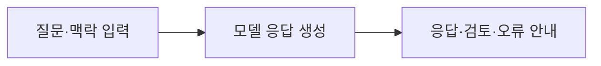

# B7-1 · 00단계 | 쉽고 작은 학습부터 시작하기

> **00단계: PLAN_ONLY** · **01 공식 요구: NOT_STARTED** · **새 코드: NOT_STARTED / 승인 PENDING** · **실행·학습 성취: NOT_VERIFIED**

**30초 요약:** 이 미션은 **웹 기반 AI 챗봇의 기본 구조**을 다룹니다. 첫 번째 용어는 <mark>프롬프트(Prompt)</mark>입니다. **개념 하나 → 그림 하나 → 질문 하나**를 이해한 후 다음으로 넘어가면 됩니다.

## 00단계의 4개 학습 영역

| 영역 | 바로가기 |
|---|---|
| A. 처음 시작하기 | [시작](#b71-00-start) |
| B. 기술 배우기 | [첫 개념·Mermaid](#b71-00-learn) |
| C. 진행 확인하기 | [현재 상태](#b71-00-status) |
| D. 상세 참고자료 | [더 알아보기](#b71-00-more) |

## A. 처음 시작하기

**무엇을 배우나요?** 웹 기반 AI 챗봇의 기본 구조. 공식 필수 요구사항은 **01단계**에서 평가표 원문과 연결합니다.

**아래에서 한 가지 출발점을 선택하세요.**

- 처음 배우기 → 아래 **B. 기술 배우기**
- 전체 개념도·기술 용어 미리보기 → [기술 학습 개요](TECHNICAL-LEARNING-OUTLINE.md)
- 현재 진행 상태만 확인 → 아래 **C. 진행 확인하기**

## B. 기술 배우기 — 오늘은 한 개념만

### 오늘의 용어: 프롬프트(Prompt)

AI 모델에 전달하는 질문·지시·맥락 등의 입력입니다. 질문 방식에 따라 답변이 달라질 수 있습니다.

**그림으로 보기 (교육용 개념도):**

**생각할 질문:** AI가 답변을 만들었다면 사실 확인은 불필요할까요?

**답과 이유:** 아닙니다. 중요한 내용은 출처·논리·독립 근거로 확인해야 합니다.
### 내 말로 설명·종이 재현 (Teach-back / Dry-run)

**두 문장으로 설명:** 프롬프트(Prompt)는 모델에 질문·지시·맥락을 전달하는 입력입니다. 출력이 문장으로 그럴듯해도 중요한 사실은 별도로 확인해야 합니다.

**입력→처리→예상 결과를 종이에 그리기**
1. **입력:** 학습용 질문이 입력됐다고 가정.
2. **처리:** 모델이 맥락을 참고해 답변을 생성하는 절차 생각.
3. **예상 결과:** 응답과 근거가 맞는지 별도 검토.

**자주 하는 오해:** 모델의 자신감이나 문장 자연스러움은 사실 검증의 증거가 아닙니다.

<ins>이 흐름은 개념 학습용 가상 재현이며 실제 신규 시스템의 실행·시험 결과가 아닙니다.</ins> [용어표·원리 안내](TECHNICAL-LEARNING-OUTLINE.md)를 참고하세요.

다음 개념은 [B7-1 기술 학습 9요소](TECHNICAL-LEARNING-OUTLINE.md)에서 하나씩 확인하세요. 전체 학습 흐름은 **용어 → 개념 → 비유 → 아키텍처 → 주요 코드 → 실행 흐름 → 오류 해결 → 실습 → 평가**입니다.

<ins>위 그림은 실제 신규 코드나 시험 결과가 아닙니다. 신규 설계는 03단계, 구현은 별도 승인 후 04단계입니다.</ins>

## C. 진행 확인하기

| 구분 | 상태 |
|---|---|
| **00단계 교육·계획 개요** | PLAN_ONLY — 문서 작성 |
| **01단계 공식 요구 분석** | NOT_STARTED |
| **03단계 상세 설계** | NOT_STARTED |
| **04단계 신규 코드** | NOT_STARTED / 승인 PENDING |
| **실제 실행·슬라이드·학습자 숙달** | NOT_VERIFIED 또는 NOT_STARTED |

**중요:** 계획/자료 반영 PASS와 **미션 기능 PASS·학습자 MASTER**는 다릅니다. 이전 Round의 결과는 보존합니다.

## D. 상세 참고자료

| 더 알고 싶은 내용 | 문서 |
|---|---|
| 용어·아키텍처·학습 예정 코드 | [기술 학습 개요](TECHNICAL-LEARNING-OUTLINE.md) |
| PRIMM·AI 힌트·L1~L5 평가 계획 | [학습체계 계획](LEARNING-SYSTEM-PLAN.md) |
| 발표·학습·심화·복습 4종 자료 | [슬라이드 계획](SLIDE-PACKAGE-PLAN.md) |
| 후속 개발단계 | [01 요구](../01-requirements/README.md) · [02 분석](../02-analysis/README.md) · [03 설계](../03-design/README.md) |
| 전체 공통 교육 규칙 | [중앙 학습 표준](https://github.com/MetaStudy999/codyssey-basic/blob/main/standards/LEARNER-CENTERED-AI-LEARNING-STANDARD.md) |

**다음 단계:** 공식 미션 PDF 및 평가표를 확인하는 01단계입니다. 새로운 코드 개발·실행은 아직 승인되지 않았습니다.

---

## 기존 00단계 계획·승인 기록 (원문 보존)

**기존 제목:** B7-1 — 공식 요구·목차·계획·승인

이 폴더는 Round 04 Agent의 계획된 작업 공간입니다. 현재 PLAN_ONLY, 사용자 개발 승인 대기. 기존 Round 보존.

## 선행 단계

[01 공식 요구](../01-requirements/README.md) → [02 기존 분석](../02-analysis/README.md) → [03 신규 설계](../03-design/README.md). 계획 문서·승인 관리와 실제 구현·검증을 구분합니다.

## 학습·발표 자료 승인 (2026-10-26)

[4종 슬라이드 계획](SLIDE-PACKAGE-PLAN.md) — 발표·학습·기술 부록·복습 자료의 목표를 기록합니다.

## 학습자 중심 AI 교육체계 승인

[통합 학습계획](LEARNING-SYSTEM-PLAN.md) — 16학습방법, PRIMM, H1~H4, L1~L5, 8개 품질 게이트, 회상·사전/사후 평가. 실제 교육자료·개발은 미착수.

## 기술 학습 9요소 — 입문자용 개요 (2026-10-26)

[B7-1 기술 용어·개념·Mermaid 개념 아키텍처·주요 코드·실습·평가 안내](TECHNICAL-LEARNING-OUTLINE.md). **용어 → 개념 → 비유 → 아키텍처 → 주요 코드 → 실행 흐름 → 오류 해결 → 실습 → 평가**를 이번 미션 기술에 맞춰 적용합니다.

현재는 **PLAN_ONLY**이며 실제 신규 구현·실행·학습자 평가 **NOT_STARTED / NOT_VERIFIED**, 개발 승인 **PENDING**은 유지합니다.
